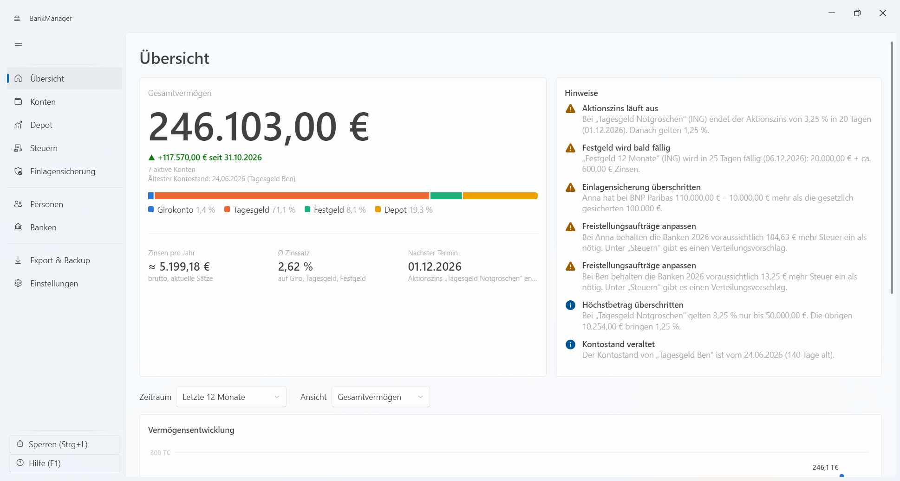
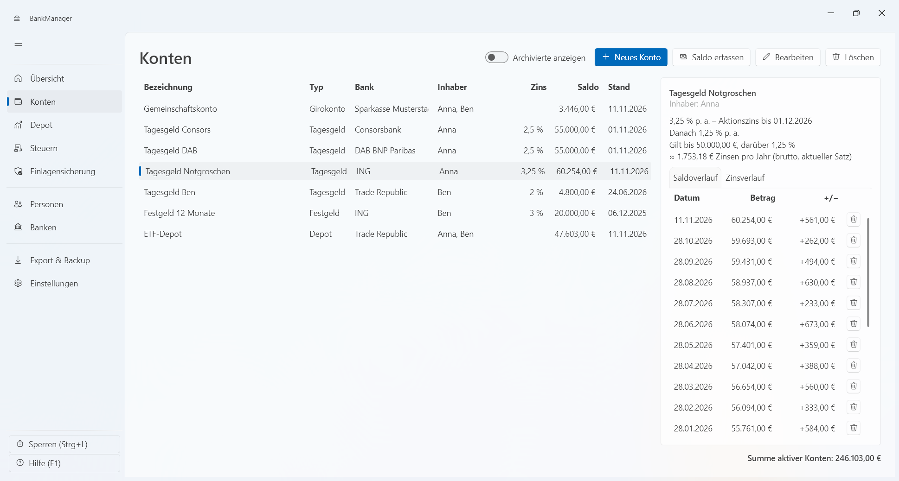
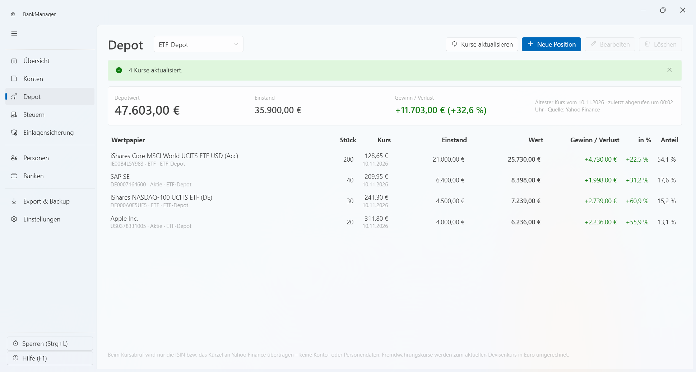
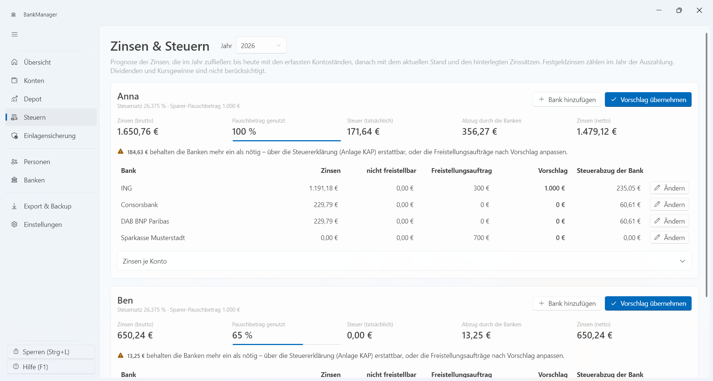

# BankManager

Windows-Programm zur privaten Verwaltung von Bankkonten: Girokonten, Tagesgeld, Festgeld und Depots
mehrerer Personen – mit Zinsprognose, Steuerberechnung und Einlagensicherung im Blick.

Produktkategorie: Finanzverwaltungssoftware (PC-Programm für Windows) · Version 1.0.0

## Funktionen

- **Konten** – Girokonto, Tagesgeld, Festgeld und Depot; mehrere Inhaber und Gemeinschaftskonten
- **Konditionen** – Zinsperioden mit Aktionszins, Folgezins und Höchstbetrag; Festgeld mit Laufzeit und Fälligkeit
- **Hinweise** – auslaufende Aktionszinsen, fällige Festgelder, veraltete Kontostände
- **Depot** – Positionen mit Einstand, aktuellem Kurs und Gewinn/Verlust
- **Zinsen & Steuern** – Jahresprognose brutto/netto, Abgeltungsteuer mit Kirchensteuer, Freistellungsaufträge
  mit Verteilungsvorschlag
- **Einlagensicherung** – Guthaben je Person und Banklizenz mit Warnung über 100.000 €
- **Export** – PDF-Vermögensbericht, Excel-Export, verschlüsselte Backups

## Datenschutz und Sicherheit

- Alle Daten liegen **lokal** in einer verschlüsselten Datenbank (AES-256, SQLCipher-4-Format), geschützt durch ein
  Master-Passwort.
- Kein Konto, keine Cloud, keine Telemetrie.
- Einzige Online-Verbindung bisher: Wertpapierkurse – dabei wird nur die ISIN übertragen, keine Konto- oder
  Personendaten.
- Automatische Sperre nach Inaktivität.

## Geplant

- Abruf von Kontoständen und Depotbeständen direkt bei der Bank über **FinTS** (PIN/TAN mit Freigabe in der
  Banking-App). Die Verbindung läuft direkt zwischen Programm und Bank – ohne Server dazwischen.

## Technik

- Windows 10/11 (x64), eine einzelne .exe ohne Installation
- C# / .NET 10, WPF

## Hinweis

Privates Projekt von [bjoern4u2](https://github.com/bjoern4u2). Der Quellcode ist nicht öffentlich.
Die Screenshots zeigen erfundene Demo-Daten.
